# Satellite Telemetry Anomaly Detection: Reproducing Telemanom-ESA on ESA-ADB

## 1. Purpose

This experiment trains the Telemanom-ESA anomaly detector on the ESA Anomaly Detection Benchmark (ESA-ADB) and compares it with the published results.

The aim is a verified baseline. Our later contributions (adaptive computation, sensor reliability, incident correlation and response planning) will be measured against it.

> **Comparing with other experiments.** These scores are only comparable with results that use the same protocol: ESA-ADB **Mission 1, channels 41-46**, the **official chronological split** (training before 2007, test 2007-2013) and the **official event-wise metrics** (`ESAScores`, corrected event-wise F0.5).
>
> Results on another mission or channel, a random or percentage split, or sample-level precision/recall/F1/PR-AUC measure a different task. They cannot be ranked against the numbers here. Sample-level F1 counts every 30-second point separately. Event-wise F0.5 counts whole anomaly events and weights false alarms more heavily.

## 2. Dataset

- **Dataset:** ESA Anomaly Dataset (ESA-AD), Zenodo record 15237121, CC BY 3.0 IGO licence
- **Mission:** Mission 1
- **Channels:** 41-46, the benchmark's "lightweight" subset. All six belong to subsystem 5.
- **Sampling:** a 30-second grid with zero-order hold, as in the official preprocessing
- **Labels:** event start and end times annotated by ESA spacecraft operations engineers

| Split | Period | Rows |
|---|---|---:|
| Training (21 months) | 2000-01-01 to 2001-10-01 | 1,840,321 |
| Training (84 months) | 2000-01-01 to 2007-01-01 | 7,364,161 |
| Test | 2007-01-01 to 2014-01-01 | 7,364,161 |

The test period contains **65 labelled events: 29 anomalies and 36 rare nominal events**.

The training-row counts match the official `datasets.csv` exactly. This confirms our data preparation reproduces the benchmark's time grid.

The validation period is the last 3 months of each training period, as in the official experiment script. The test period is never used for training or tuning.

## 3. Model

**Telemanom-ESA** (Hundman et al. 2018, adapted by Kotowski et al. 2024) is a forecasting detector:

1. A two-layer LSTM (80 units each, dropout 0.3) reads the last 250 samples (about 2 hours) of all six channels. It predicts the next 10 samples.
2. The error between forecast and actual value is smoothed for each channel.
3. A non-parametric dynamic threshold flags unusually large errors. The original `errors.py` from the ESA-ADB repository does this step, unchanged.

The two variants share one trained model and differ in a single setting:

| Variant | `min_error_value` | Effect |
|---|---|---|
| Telemanom-ESA | 0 | Every error spike above the dynamic threshold raises an alarm |
| Telemanom-ESA-Pruned | 0.007 | Error spikes smaller than 0.007 are ignored |

## 4. Experimental Setup

| Setting | Value | Source |
|---|---|---|
| Window / forecast horizon | 250 / 10 samples | Official defaults |
| Batch size, optimiser | 70, Adam (learning rate 0.001) | Official defaults |
| Steps per epoch | 1,000 | Official code |
| Early stopping | patience 20, min delta 0.0003 on validation loss | Official experiment script |
| Weights used | Last epoch | The original overwrites its best checkpoint with the final model |
| Seeds | 42, 1, 2, 3, 4 | Ours, to measure run-to-run variation |
| Hardware | NVIDIA RTX 5060 Laptop GPU, Intel Core Ultra 9 275HX | |
| Framework | PyTorch 2.11 (CUDA 12.8) | The official TensorFlow 2.5.1 image cannot use this GPU |

All scores are computed by the official ESA-ADB metric code (`ESAScores`), loaded unmodified from the benchmark repository at commit 67194d3. Ten hand-calculated test cases confirmed the metric code behaves as documented before we used it.

**Main metric:** the corrected event-wise F0.5-score. It counts whole events rather than single samples, weights precision above recall (so false alarms cost more than misses), and penalises the share of nominal time covered by false alarms.

## 5. Results

### 5.1 Comparison with the published paper

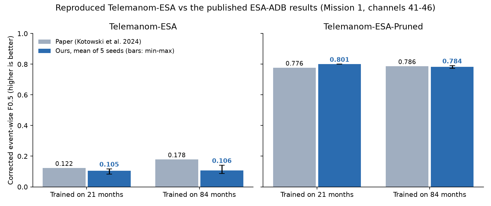

Corrected event-wise F0.5, anomalies and rare events, mean of five seeds:

| Model | Training data | Paper | Ours (mean) | Ours (min-max) | Difference |
|---|---|---:|---:|---:|---:|
| **Telemanom-ESA-Pruned** | 21 months | 0.776 | **0.801** | 0.801-0.801 | **+0.025** |
| **Telemanom-ESA-Pruned** | 84 months | 0.786 | **0.784** | 0.773-0.791 | **-0.002** |
| Telemanom-ESA | 21 months | 0.122 | 0.105 | 0.084-0.117 | -0.017 |
| Telemanom-ESA | 84 months | 0.178 | 0.106 | 0.087-0.141 | -0.072 |

**Telemanom-ESA-Pruned, the paper's best Mission 1 model, reproduces the published result**: it exceeds it at 21 months (+0.025) and matches it at 84 months (-0.002). Both are within our ±0.03 acceptance band. The unpruned variant scores lower than the paper, mainly because it raises more false alarms (Section 5.4).

### 5.2 All official metrics

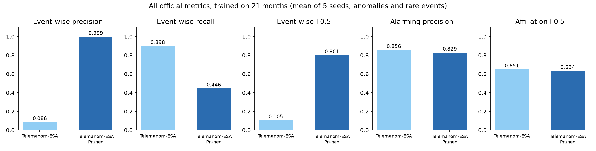

Telemanom-ESA-Pruned, trained on 21 months, mean of five seeds:

| Metric | All events | Anomalies only |
|---|---:|---:|
| Event-wise precision (corrected) | 0.999 | 0.999 |
| Event-wise recall | 0.446 | 0.862 |
| **Event-wise F0.5** | **0.801** | **0.968** |
| Alarming precision | 0.829 | 0.806 |
| Affiliation-based F0.5 | 0.634 | 0.913 |

The 84-month chart is in `results/figures/2_all_metrics_84_months.png`.

### 5.3 Event-level results

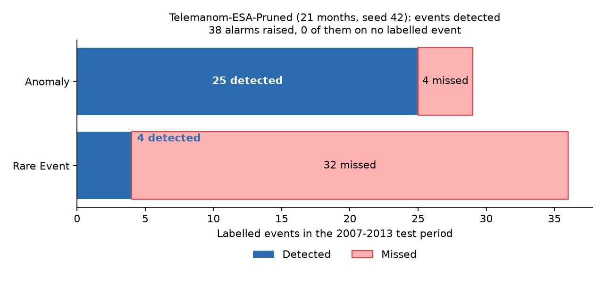

Telemanom-ESA-Pruned, trained on 21 months, seed 42:

| | Detected | Missed | Total |
|---|---:|---:|---:|
| Anomalies | **25** | 4 | 29 |
| Rare nominal events | 4 | 32 | 36 |
| Alarms that hit no labelled event | 0 | | |

The model finds 25 of the 29 real anomalies, and none of its alarms land outside a labelled event. Most missed events are rare nominal events: unusual but harmless spacecraft behaviour, which ESA engineers annotated and the benchmark still counts.

### 5.4 Example detection

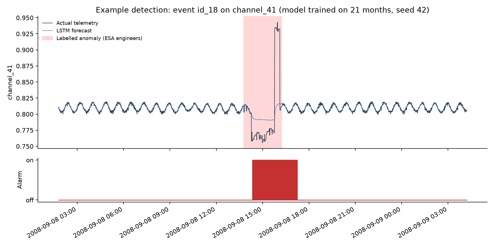

The LSTM forecast (blue) follows the normal periodic signal closely. When the channel drops and then jumps during a labelled anomaly, the forecast cannot follow, the error grows and the alarm switches on.

### 5.5 Run-to-run stability and training

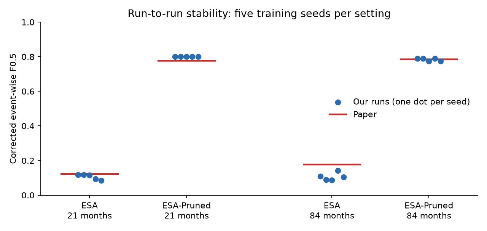

- **Pruned variant:** at 21 months, all five seeds give the same event-wise F0.5 (0.801). The five models make different predictions and flag different samples (34,033 to 34,658), but they catch the same events. The fixed 0.007 error gate decides which events survive, more than the network does. At 84 months, three seeds score 0.791 and two score 0.773: those two each raised one false alarm, and all five caught the same events.
- **Unpruned variant:** this varies by seed: 0.084 to 0.117 at 21 months. At 84 months its recall matches the paper (0.898 mean here, 0.894 in the paper), but its precision is lower (0.071-0.117, paper 0.148). It therefore raises more false alarms than the paper's single run.

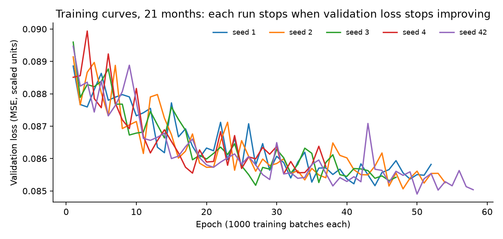

At 21 months, training stopped after 37 to 58 epochs and took 5.5 to 10.5 minutes per seed. At 84 months, it stopped after 26 to 43 epochs and took 3.6 to 6.7 minutes. Scoring the 7-year test period takes about 10 minutes per model.

## 6. Related IEEE Papers

Three IEEE papers on satellite telemetry anomaly detection that our project builds on and combines:

| # | IEEE paper | What it does | What we take from it |
|---|---|---|---|
| 1 | Z. Zeng, G. Jin, C. Xu, S. Chen, Z. Zeng, L. Zhang, "Satellite Telemetry Data Anomaly Detection Using Causal Network and Feature-Attention-Based LSTM," *IEEE Transactions on Instrumentation and Measurement*, vol. 71, 2022. doi:10.1109/TIM.2022.3151930 | Builds a causal network between telemetry parameters (transfer entropy), predicts telemetry with an attention LSTM, and flags anomalies with a nonparametric dynamic k-sigma threshold. Reports F1 0.9462 and FPR 0.0021 on a real satellite. | Same detection principle as our baseline: LSTM forecasting plus a dynamic threshold. Its causal network motivates our dependency-graph contribution (C3), which links alarms across channels. Its focus on cutting false positives matches our F0.5 metric, which weights precision above recall. |
| 2 | Z. Xu, Z. Cheng, B. Guo, "A Multivariate Anomaly Detector for Satellite Telemetry Data Using Temporal Attention-Based LSTM Autoencoder," *IEEE Transactions on Instrumentation and Measurement*, vol. 72, 2023. doi:10.1109/TIM.2023.3296125 | A temporal-attention LSTM autoencoder for multivariate telemetry. It scores anomalies by the Mahalanobis distance of the reconstruction error, uses an adaptive threshold balancing reliability and accuracy, and identifies which parameters caused each anomaly. | Its adaptive threshold and per-parameter attribution feed our trust-aware decision layer. Our results show the threshold, not the network, decides which events are caught (Section 5.5). Its attribution step relates to our sensor-reliability contribution (C2). |
| 3 | Y. Zhang, P. Hu, "A Fourier Graph Attention Network for Satellite Anomaly Detection," *2025 IEEE Canadian Conference on Electrical and Computer Engineering (CCECE)*, 2025. doi:10.1109/CCECE64018.2025.11364456 | Fourier-GAT combines graph attention with frequency-domain features to capture relationships across channels and time in satellite telemetry. It targets anomaly detection with root-cause analysis and reports better results than mainstream methods on three real datasets. | A graph-based model across channels, the direction of our dependency-graph work (C3). Our telemetry is strongly periodic (Section 5.4), so frequency features suit it. |

Also relevant: A. Mathur, S. Paheding, J. Salafia, S. Salafia, "ADEPTRS: Adversarially Resilient Anomaly Detection for Satellite Telemetry under Evasion and Poisoning Attacks," *IGARSS 2026*, doi:10.1109/IGARSS60577.2026.11730340. It tests how robust telemetry anomaly detectors are, which is relevant to the "trust-aware" part of our title.

**Sources of the dataset and baseline model** (not IEEE, cited because we reproduce them):

- K. Kotowski et al., "European Space Agency Benchmark for Anomaly Detection in Satellite Telemetry," arXiv:2406.17826, 2024. The ESA-ADB dataset, metrics and the published results in Section 5.1.
- K. Hundman et al., "Detecting Spacecraft Anomalies Using LSTMs and Nonparametric Dynamic Thresholding," KDD 2018, arXiv:1802.04431. The original Telemanom method.

## 7. How to Run

```bash
cd src
python fetch_subset.py            # download channels 41-46 and labels (506 MB)
python prepare.py 21_months       # build the 30-second grid; also 84_months
python test_metrics.py            # check the official metric code
python train.py 21_months --seed 42
python evaluate.py 21_months --seed 42
python summarize_seeds.py 21_months
python make_figures.py            # charts in results/figures/
```

Each step resumes after an interruption. `run_seeds.py 21_months 42 1 2 3 4` runs several seeds in a row.

## 8. Output Files

| File | Contents |
|---|---|
| `results/telemanom_<months>_seed<n>_last.json` | All official metrics for one run |
| `results/seed_summary_<months>_last.md` | Mean, spread and per-seed values |
| `results/figures/` | Charts used in this report (1-6 reproduction, 7-11 contributions C1-C5), and `tables.json` |
| `results/h1_result.json` ... `h5_result.json`, `c5_result.json` | Test-set results of each hypothesis and the ablation |
| `results/test_log.md` | Every test-set run, with date and commit |
| `models/telemanom_<months>_seed<n>/last.pt` | Trained model weights |

## 9. Limitations

1. The LSTM results use only the six lightweight channels of Mission 1. C3 (section 16) uses all 76 channels with cheap per-channel detectors, not the LSTM. Mission 2 has not been evaluated.
2. The model is a PyTorch port, not the original TensorFlow 2.5.1 code. The settings and thresholding code match, but small numerical differences remain. They are the most likely reason the unpruned variant has lower precision than the paper.
3. The current Zenodo labels give 65 test events. The paper's recall values (0.894 = 59/66 and 0.424 = 28/66) imply 66. This suggests a later label revision, which we have not confirmed.
4. The Pruned variant's 0.007 threshold was hand-picked by the paper's authors. Its results depend on that one number.
5. Recall is low on rare nominal events (4 of 36 detected).

## 10. Next Steps

Status as of 2026-11-10:

1. Freeze the evaluation protocol (phase P2): **done**, see `PROTOCOL.md` and section 12.
2. Build adaptive computation (C1): **done and confirmed**, see section 13. The later contributions C2-C5 are in sections 14-18.
3. Improve rare-event recall without adding false alarms: **still open**. None of the contributions changes recall: the baseline finds 4 of 36 rare events, and the calibrated floor in section 12 adds only 2-3.

## 11. Conclusion

We trained Telemanom-ESA on ESA-ADB Mission 1 and evaluated it with the official benchmark code. **The Pruned variant reaches a corrected event-wise F0.5 of 0.801 at 21 months (paper: 0.776) and 0.784 at 84 months (paper: 0.786), averaged over five training seeds.**

This gives a verified, reproducible baseline for the project's contributions. It also shows where the room for improvement lies: the decision layer that turns forecast errors into alarms, and recall on rare events.

## 12. Update (2026-11-08): calibrated error floor (H1)

The Pruned variant's error floor of 0.007 was hand-picked by the paper's authors. Under the frozen protocol in `PROTOCOL.md`, we chose a floor from 8 candidates on a labelled development period (2001-10 to 2006-12, 33 events, unseen by the 21-month models). We then applied it **once** to the test set.

| Floor (development, mean of 5 seeds) | 0 | 0.003 | **0.005** | 0.007 | 0.01 | 0.015 | 0.02 | 0.03 |
|---|---|---|---|---|---|---|---|---|
| Event-wise F0.5 | 0.096 | 0.485 | **0.816** | 0.776 | 0.752 | 0.752 | 0.538 | 0.492 |

0.005 was best on all 5 seeds in development.

**Test result (21 months, 5 seeds):**

| | Paper's floor 0.007 | Calibrated 0.005 | Difference (95% CI, paired monthly bootstrap) |
|---|---|---|---|
| F0.5, all events | 0.801 | **0.818** | +0.017 [−0.009, +0.055] |
| F0.5, anomalies only | 0.968 | 0.957 | −0.012 [−0.032, −0.000] |
| Events found (of 65) | 29 | 31-32 | +2 to +3, all rare events |
| False alarms | 0 | 0 (3 seeds), 1 (2 seeds) | |

**Verdict: no clear difference.** The calibrated floor scores higher on every seed and finds 2-3 more rare events. However, the 95% interval includes zero, so by the protocol this is not a confirmed improvement. Anomaly detection is unchanged at 25 of 29. The small anomalies-only drop comes from one extra false alarm in two of the five seeds.

This is the main lesson for the next contributions. With only 65 test events, a gain of about 0.02 F0.5 is within run-to-run noise, so a confirmed improvement needs either a larger effect or more events (the full channel set). Full numbers: `results/h1_result.json`. Test-set log: `results/test_log.md`.

## 13. Update (2026-11-09): adaptive computation (C1, hypothesis H2)

**Idea.** The original detector runs the LSTM on every 30-second reading. C1 adds a cheap screening tier that watches everything and calls the LSTM only when something looks wrong. The tier has three signals:
- **Confidence:** a small linear forecaster's error.
- **Novelty:** how unusual the recent pattern is compared with the training data.
- **Impact:** how many channels deviate at once.

When the screener fires, the LSTM runs on a burst around that point, because its alarm logic needs about 2,100 samples of error history. The burst covers 2,400 samples of warm-up and 2,100 of look-back before the trigger, and 2,100 after it. Every sample in a burst counts as LSTM work, padding included.

**Development period (21-month models, 5 seeds; setting chosen by the frozen rule in `PROTOCOL.md`, addendum 1):**

| Screening threshold τ | F0.5, full router | LSTM share | F0.5, confidence signal only |
|---|---|---|---|
| 0.995 | 0.776 | 99.1% | 0.776 |
| 0.998 | 0.776 | 54.7% | 0.776 |
| 0.999 | 0.776 | 12.3% | 0.776 |
| 0.9995 | 0.752 | 2.3% | 0.752 |
| 0.9999 | 0.752 | 2.1% | 0.730 |

Full-LSTM development F0.5: 0.776. The rule picks the smallest LSTM share within 0.01 of that score: **τ = 0.999**. Novelty and impact add little at τ = 0.999. They matter at the most aggressive setting, τ = 0.9999, where they hold 0.752 against 0.730 for confidence alone.

**Test result (run once, 5 seeds):**

| | Always-on LSTM (B0) | C1 adaptive |
|---|---|---|
| F0.5, all events | 0.8007 | **0.8007** (difference +0.0000, 95% CI [+0.0000, +0.0000]) |
| F0.5, anomalies only | 0.9684 | 0.9684 |
| Share of test data the LSTM runs on | 100% | **6.4%** |
| Measured LSTM inference time (seed 42, GPU) | 844 s | 29 s LSTM + 12 s screening (52 bursts) |
| End-to-end inference speed-up | 1× | **20.3×** |

**Verdict: non-inferior, with a 20-fold cut in inference time.** C1 catches exactly the same events with the same false alarms on every seed, while running the LSTM on 6.4% of the test data. This is the project's first confirmed contribution. The speed-up was measured in a single run on one laptop: both timings come from the same session, but the absolute seconds depend on machine load.

Limits:
- **Unchanged recall:** C1 saves compute but cannot find events the baseline misses.
- **Lookback found on development data:** the 2,100-sample lookback was found after a first design failed on the development period. Both the failure and the fix are recorded in `PROTOCOL.md`.
- **Interrupted run:** the test run was interrupted by a PC shutdown during the timing step and re-executed. The scores are deterministic and identical in both runs (`results/h2_run.log`).

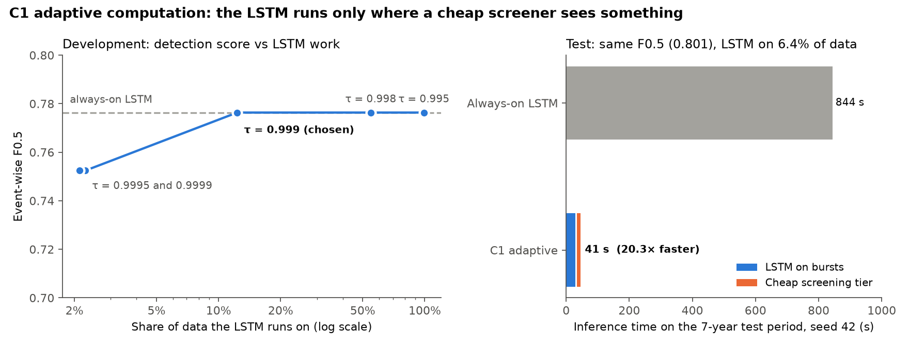

Full numbers: `results/h2_result.json`, `results/c1_dev.json`.

## 14. Update (2026-11-09): sensor reliability (C2, hypotheses H3a and H3b)

**Idea.** A broken sensor and a real spacecraft problem can both make the LSTM raise an alarm, but they need different responses: a maintenance ticket against an incident response. Channels 41-46 form one sensor group, and in the test period 62 of the 64 events with a channel count move all six channels together. C2 asks four questions of every alarm:
- Does one channel disagree with what its five peers predict?
- How many channels are involved?
- Does the signal look stuck, noisy or out of range?

A logistic model turns these features into P(sensor fault). Alarms above the threshold become "sensor fault" and leave the system-alarm stream.

**Data.** ESA-AD has no sensor-fault labels, so 50 single-channel faults were injected into each period, 10 each of stuck, drift, bias, noise and dropout, as fixed in `PROTOCOL.md` addendum 2 before any C2 run. The model and threshold were fitted on the development period only. The resulting threshold is 0.498, with development sensor-fault F1 0.949, and 3 of 114 real-event alarms suppressed.

**Test result (run once, 5 seeds, scored against the real labels only):**

| Condition | Always-on LSTM (B0) | With C2 | Difference (95% CI) | Verdict |
|---|---|---|---|---|
| Test with injected sensor faults (H3a) | 0.341 | **0.628** | +0.288 [+0.223, +0.356] | improvement |
| Clean test, no faults (H3b) | 0.8007 | 0.7987 | -0.0020 [-0.0076, +0.0000] | no harm (non-inferior) |

Without C2, every injected fault the LSTM notices becomes a false system alarm, roughly halving F0.5. With C2 most of those alarms are correctly re-labelled, recovering about 0.29 F0.5. On clean data C2 almost never fires: it re-labelled 1 real-event alarm in one of the five seeds.

**Attribution by fault type (test, 5 seeds × 10 faults each):**

| Fault type | Injected | Raised an LSTM alarm | Correctly attributed to the sensor |
|---|---|---|---|
| stuck | 50 | 27 (54%) | 20 of 27 (74%) |
| drift | 50 | 48 (96%) | 48 of 48 (100%) |
| bias | 50 | 50 (100%) | 50 of 50 (100%) |
| noise | 50 | 50 (100%) | 50 of 50 (100%) |
| dropout | 50 | 50 (100%) | 48 of 50 (96%) |

Bias, noise, drift and dropout faults are almost always caught and attributed. Stuck sensors are the weak spot: frozen values often look normal to the LSTM, so only about half raise an alarm at all.

**Limits.**
- *Injected faults only:* the injected faults come from the same simple generator used for development, so the result is likely optimistic for real sensor failures.
- *Single-channel faults only:* faults hitting several sensors at once were not tested.
- *Favourable group:* C2 relies on correlated peer channels, which this 6-channel group provides. Groups without close peers would be harder.

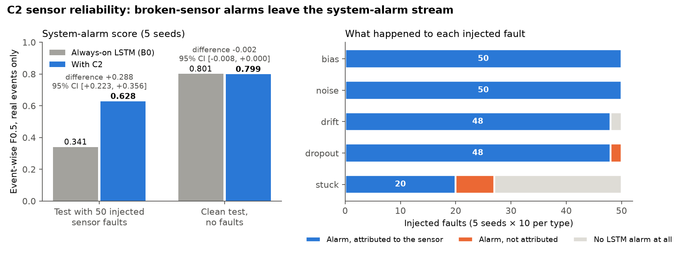

Full numbers: `results/h3_result.json`, `results/c2_dev.json`.

## 15. Update (2026-11-09): cost-aware response replay (C4, hypothesis H5)

**Idea.** Detecting an alarm is only half the job: someone has to decide what to do with it. Each alarm on the fault-injected test period gets one of three actions. A *page* calls an operator now, a *ticket* opens a maintenance task and a slower response, and *ignore* drops it. Each policy's cost is replayed on the recorded timeline.

This is a counterfactual replay of the **alert policy only**, not of the spacecraft's behaviour. ESA-AD has no cost or response records, so results hold for the declared cost grid in `PROTOCOL.md` addendum 4. The grid has 36 points; the most important parameters are the cost of ignoring an anomaly M, of delaying it D, and of a false page F.

**Policies:**
- **P0:** page every alarm.
- **P1:** use C2's sensor-fault label: ticket sensor faults, page everything else.
- **P2 (proposed):** a learned model estimates whether each alarm is an anomaly, rare event, sensor fault or false alarm. It then picks the cheapest action in expectation.
- **Oracle:** knows the truth.

Test alarms, 5 seeds pooled: 170 anomaly, 20 rare event, 287 sensor fault and 17 false.

| Policy | Cost at the central point (M = 50, D = 5, F = 1, S = 1) | Ranked first across the 36 grid points |
|---|---|---|
| P0 page everything | 64.8 | 0 |
| **P1 C2 sensor rule** | **17.2** | **24** |
| P2 learned cost-aware | 34.9 | 12 |
| Oracle | 0.0 | n/a |

**Verdict: H5 not supported.** P2 beats both P0 and P1 at only 12 of 36 grid points; the protocol required 80%. At the central point P2 costs +17.7 more than P1, with 95% CI [-9.7, +56.6].

P2 wins mainly when delaying a real anomaly is cheap (D = 2: 8 of 12 points) and false pages are expensive (F = 3). It never wins when delay is expensive (D = 10: 0 of 12). It misjudges some real anomalies as ticket-worthy, which is costly whenever delay matters.

**What did work:** the simple C2-driven rule P1 cuts response cost against paging everything at **every** grid point, from 64.8 to 17.2 at the central point. For the response-planning question, a reliable sensor-fault label matters more than a learned cost model. This negative result is useful in its own right: a more complex policy is not automatically better.

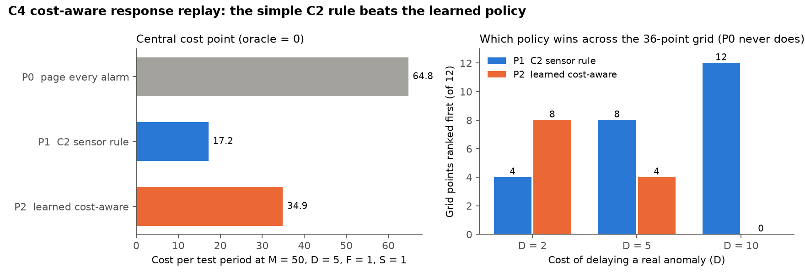

Full numbers: `results/h5_result.json`.

## 16. Update (2026-11-10): incident correlation across all 76 channels (C3, hypothesis H4)

**Idea.** On the full Mission 1 channel set, one real incident sets off alerts on many channels at once, so an operator faces a flood of separate alerts. C3 groups alerts into incidents. The proposed method (G2) merges alerts only if they are close in time **and** their channels are linked in a dependency graph. The graph is learned from training data, as the correlation between channels' residual activity.

**Setup** (fixed in `PROTOCOL.md` addendum 3):
- *Data:* all 76 channels, prepared on one 30-second grid.
- *Alerts:* a cheap per-channel forecaster raises alerts above its own 99.99th training percentile.
- *Tuning:* W and ρ were tuned on the development period.
- *Test:* run once against the ESA event IDs.

The test period has 22,420 alerts, 1,996 of them on labelled events.

| Grouping | Pairwise F1 | Precision | Recall | Incidents per event | Incidents mixing events | Total incidents |
|---|---|---|---|---|---|---|
| G0 no grouping | 0.000 | 0.000 | 0.000 | 30.24 | 0 | 22,420 |
| G1 time only (W = 720) | 0.978 | 0.993 | 0.963 | 1.48 | 4 | 1,913 |
| G2 learned graph (W = 2880, ρ = 0.1) | 0.406 | 1.000 | 0.254 | 7.41 | 1 | 3,516 |
| G2 with subsystem prior (comparison) | 0.893 | 1.000 | 0.807 | 1.64 | 1 | 1,115 |

**Verdict: H4 not supported; the learned graph is worse.** G2 minus G1 pairwise F1 is -0.572, with 95% CI [-0.576, -0.179]. The learned graph never merges two different events (precision 1.0), but it splits most real incidents: only 25% of same-event alert pairs end up together.

Training data contains few incidents, so the residual-activity correlations are weak and the graph is too sparse. The development period showed the same pattern (best G2 F1 0.801 vs G1 0.897).

**What did work:**
- **Grouping by time alone (G1)** cuts operator load from **30.2 alerts per event to 1.48 incidents per event**, with pairwise F1 0.978. In ESA-ADB, separate incidents rarely overlap in time, which is why time-based grouping is already enough.
- **The known subsystem structure** used as the graph keeps precision at 1.000 (only 1 mixed incident, against 4 for G1) with F1 0.893. That would matter on missions where incidents in different subsystems happen at the same time.

Limits: channel names are anonymised, so any graph shows statistical association, not physical causation. The cheap per-channel detectors also raise many alerts on nominal data (20,424 of 22,420 in the test period). That affects operator load, but not the pairwise grouping score.

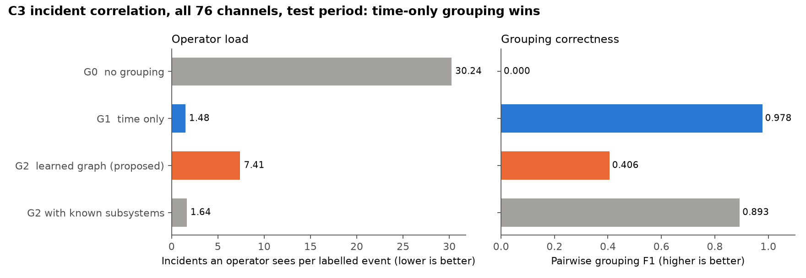

Full numbers: `results/h4_result.json`, `results/c3_dev.json`.

## 17. Summary of all contributions

| Contribution | Hypothesis | Result | Status |
|---|---|---|---|
| Reproduction (Telemanom-ESA-Pruned) | G1 gate | 0.801 vs paper 0.776 (21 months), 0.784 vs 0.786 (84 months) | **Reproduced** |
| Calibrated error floor | H1 | 0.818 vs 0.801, 95% CI includes 0 | Not confirmed |
| **C1 adaptive computation** | H2 | Same F0.5 (0.8007), LSTM on 6.4% of data, **20.3× faster** | **Confirmed** |
| **C2 sensor reliability** | H3a, H3b | **+0.288 F0.5** with injected sensor faults; no harm on clean data | **Confirmed** (injected faults only) |
| C3 incident correlation | H4 | Learned graph worse than time-only grouping; time grouping cuts alerts 30.2 → 1.48 per event | Not supported |
| C4 cost-aware response | H5 | Learned policy best at 12 of 36 cost points; the C2 sensor rule beats page-everything at all 36 | Not supported |
| C5 ablation | descriptive | C1 + C2 + time grouping + the C2 ticket rule (L4) is the best combination: F0.5 0.628 vs 0.341, LSTM on 11.9%, 8% fewer operator items, cost 17.2 vs 64.8 | See section 18 |

Every test-set run is listed in `results/test_log.md`. Each was run once, after its design was committed in `PROTOCOL.md`.

## 18. Update (2026-11-10): ablation of the combined system (C5)

**Idea.** Each contribution was tested on its own. C5 puts them into one pipeline and switches each one off in turn, to show what each adds when combined. The design (configurations A0-A8 and leave-one-out L1-L4) was committed in `PROTOCOL.md` addendum 5 before the run. Nothing was re-tuned. The study is descriptive, with no new hypothesis.

**Pipeline:**
- *Detector:* the C1 router or the always-on LSTM.
- *C2:* removes sensor-fault alarms from the system stream and tickets them.
- *C3:* merges alarms less than 2,880 samples (24 hours) apart into one incident. The learned graph links all six channels, so here it reduces to time grouping.
- *C4:* chooses page, ticket or ignore with the learned cost model.

**Setting.** Channels 41-46, 21-month models, 5 seeds, on the test period with C2's 50 injected sensor faults. F0.5 on the clean test period is shown too. Cost is at the central grid point (M = 50, D = 5, F = 1, S = 1); regret is the mean over all 36 grid points.

| Config | What is on | F0.5 injected | F0.5 clean | LSTM share (injected / clean) | Operator items | Cost | Mean regret |
|---|---|---|---|---|---|---|---|
| A0 | always-on LSTM | 0.341 | 0.801 | 100% / 100% | 98.8 | 64.8 | 129.6 |
| A1 | cheap tier alone, no LSTM | 0.106 | 0.153 | 0% / 0% | 456.0 | 410.0 | 820.0 |
| A2 | C1 confidence only | 0.337 | 0.801 | 11.9% / 6.4% | 100.0 | 66.0 | 132.0 |
| A3 | C1 confidence + impact | 0.337 | 0.801 | 11.9% / 6.4% | 100.0 | 66.0 | 132.0 |
| A4 | C1 full | 0.341 | 0.801 | 11.9% / 6.4% | 98.8 | 64.8 | 129.6 |
| A5 | C1 + C2 | 0.628 | 0.799 | 11.9% / 6.4% | 98.8 | **17.2** | **33.5** |
| A6 | C1 + C3 | 0.341 | 0.801 | 11.9% / 6.4% | **81.0** | 64.8 | 129.6 |
| A7 | C1 + C4 (no-C2 variant) | 0.341 | 0.801 | 11.9% / 6.4% | 98.8 | 70.2 | 61.3 |
| A8 | full system | 0.628 | 0.799 | 11.9% / 6.4% | 91.2 | 34.9 | 41.4 |
| L1 | A8 minus C1 | 0.628 | 0.799 | 100% / 100% | 91.2 | 34.9 | 41.4 |
| L2 | A8 minus C2 | 0.341 | 0.801 | 11.9% / 6.4% | 81.0 | 70.2 | 61.3 |
| L3 | A8 minus C3 | 0.628 | 0.799 | 11.9% / 6.4% | 98.8 | 34.9 | 41.4 |
| **L4** | **A8 minus C4 (C2 ticket rule instead)** | **0.628** | 0.799 | 11.9% / 6.4% | 91.2 | **17.2** | **33.5** |

Operator items are alarm events, or incidents when C3 is on, per test period. No incident mixed a real event with an injected fault in any configuration.

**Intervals (paired monthly bootstrap, injected test).**
- *Full system against the baseline (A8 − A0):* F0.5 +0.288, 95% CI [+0.223, +0.356].
- *Removing C2 (A8 − L2):* the same +0.288.
- *Removing C1, C3 or C4 (A8 − L1, L3, L4):* F0.5 unchanged, interval [0, 0].
- *Cost, keeping C4 against the C2 rule (A8 − L4):* +17.7, 95% CI [−9.7, +56.6].

**What each contribution adds:**
- **C1 (compute):** the full router keeps every score of the always-on LSTM while running it on 11.9% of the faulty test data and 6.4% of the clean test data. Injected faults trigger extra bursts, which is why the share is higher. Without the novelty signal (A2, A3), the router raises slightly more alarms on the faulty data (100.0 against 98.8 per period) and F0.5 drops slightly, from 0.341 to 0.337. On clean data the three variants are identical. The cheap tier cannot replace the LSTM: on its own (A1) F0.5 falls to 0.106, and it raises 4.6 times as many alarms.
- **C2 (detection quality):** the only component that changes F0.5. Removing it loses all of the +0.288 gain, and it is also what makes the cheap response policy possible. The cost of keeping it is one real-event alarm removed in one of the five clean seeds (0.801 → 0.799).
- **C3 (operator load):** time grouping cuts the items an operator handles from 98.8 to 81.0 (−18%) on its own. In the full system it cuts them to 91.2 (−8%), because sensor tickets and system alarms are kept in separate streams. It never merged a real event with a sensor fault.
- **C4 (response cost):** the learned policy makes the combined system worse. Replacing it with C2's simple ticket rule (L4) halves the central cost, from 34.9 to 17.2, and lowers the mean regret from 41.4 to 33.5. This matches the H5 result. Without C2, the learned policy (A7) still halves the regret of paging everything (61.3 against 129.6), so a learned triage has value only when no sensor-fault label exists.

**Conclusion.** The best combination is **L4**: the C1 router, C2 sensor reliability, C3 time grouping and the C2 ticket rule. Compared with the always-on baseline on faulty data, it:
- raises F0.5 from 0.341 to 0.628;
- runs the LSTM on 11.9% of the data;
- gives the operator 8% fewer items;
- cuts response cost at the central point from 64.8 to 17.2.

On clean data it matches the baseline (0.799 against 0.801). The study's limits are those of its parts: sensor faults are injected, there is one 6-channel group, and the cost grid is declared rather than measured.

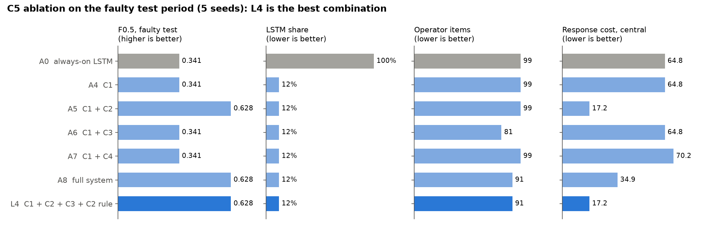

Full numbers: `results/c5_result.json`. Run log: `results/c5.log`.
